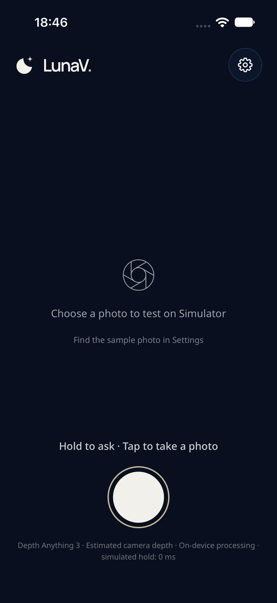
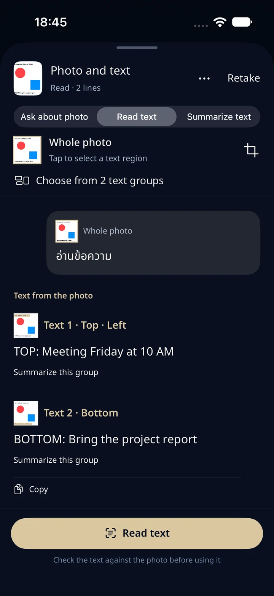
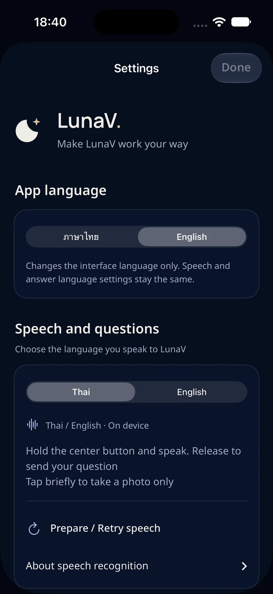

<div align="center">


# LunaV

Current full app: **3.2.2 (build 7)**. [Download the 3.2.2 source release](https://github.com/koomean/visionassistant/releases/tag/v3.2.2-source). Earlier validation results below retain their original version labels.

### Ask about the world around you. Privately, on your iPhone.

**An experimental, on-device AI visual assistant** built to explore more accessible ways to understand photographs, read text, and estimate supported distances.

**No cloud AI API · Thai & English · SwiftUI · LiDAR + Depth Anything 3**

[**Explore the website**](https://lunavision.koomean.com/) · [**Try the interactive demo**](https://lunavision.koomean.com/demo.html) · [**Get the source**](https://github.com/koomean/visionassistant/releases) · [**Read the research status**](PROJECT-STATUS.md)


[](LICENSE)

</div>

---

## A visual assistant designed around simple interactions

LunaV explores a straightforward idea: **point your iPhone at something, ask a question, and hear an answer**—with image analysis performed on the device rather than sent to a cloud AI service.

It is a **research prototype**, not a certified accessibility or mobility product. Its answers and distance estimates can be incorrect, and it must **not** be used as a navigation aid or a substitute for a cane, guide dog, or other mobility support.

### See the interface

<div align="center">
  
  &nbsp;
  
  &nbsp;
  
  <br>
  <sub>App interface previews. Actual screens and feature availability depend on the build and device.</sub>
</div>

## What can LunaV do?

| Capability | How it works |
| --- | --- |
| **Ask about a scene** | Capture an image and ask a question using Qwen3-VL-2B-Instruct running through MLX/Metal. |
| **Speak in Thai or English** | Hold the main button, speak in the selected Dictation language, and release to submit. |
| **Read printed text** | Apple Vision performs on-device OCR, including requests to read specific regions of an image. |
| **Summarise text** | Summarise extracted text from signs, labels, menus, and other readable material. |
| **Estimate distance** | Use paired LiDAR depth on supported captures, or Depth Anything 3 Metric on non-LiDAR iPhones. |
| **Hear the response** | Play completed answers using installed Apple system voices. |
| **Choose your language** | Switch the app interface between Thai and English independently of speech and voice settings. |

**Interaction tip:** Hold the centre button to capture and speak, then release to submit. A short tap captures a photo without recording speech. Voice questions have a two-minute recording limit.

## On-device by design

```text
                iPhone camera + microphone
                            |
                     LunaV (SwiftUI)
                            |
       +--------------------+--------------------+
       |                    |                    |
  Visual questions      Text reading       Distance requests
  Qwen3-VL-2B           Apple Vision OCR    LiDAR (if supported)
  MLX / Metal                                or DA3 Metric
       |                    |                    |
       +--------------------+--------------------+
                            |
                    Answer / summary
                            |
                  Apple system voice
```

LunaV processes its core image, depth, OCR, question-transcription, and answer-generation tasks locally. **No cloud AI service or API key is required for those tasks.**

**Offline caveat:** Apple Dictation language assets or voices may need to be installed first. A fresh installation is therefore **not guaranteed to be fully usable offline immediately**. Temporary photos and audio may remain inside the app sandbox while their processing tasks finish.

## Choose a release

The repository's `main` branch contains the **project website**, documentation, and licensing notices. **The Xcode app source is distributed through GitHub Releases**, not directly in the root repository tree.

| | **LunaV 3.2.1** | **LunaV Lite 4.0.0** |
| --- | --- | --- |
| Focus | On-device visual question answering | A separate, lighter photo/text toolset |
| Target | iPhone | iPhone and iPad |
| Core technology | Qwen3-VL-2B-Instruct, MLX/Metal, Apple Vision, LiDAR / DA3 Metric | Apple Vision and a compressed DA3 model |
| Source package | [`v3.2.1-source`](https://github.com/koomean/visionassistant/releases/tag/v3.2.1-source) | [`v4.0.0-lite`](https://github.com/koomean/visionassistant/releases/tag/v4.0.0-lite) |
| Included model files | **Not included** in the 3.2.1 source ZIP | Compressed Depth Anything 3 included in the Xcode project |

**For LunaV 3.2.1:** Open the release's **Assets** and download `LunaV-3.2.1-source.zip` and `SHA256SUMS.txt`. Verify the source archive against the published checksums. The ZIP is **source code, not an installable iPhone app**; model preparation and your own Xcode signing are required.

### Development requirements

- **iOS 27.0+** and **Xcode 27.1+** for LunaV 3.2.1 (recorded testing used Xcode 27.2).
- Supported iPhone hardware and sufficient available memory for the relevant models.
- Apple development signing and Developer Mode for installation on a physical device.
- Relevant Apple language assets installed for offline Dictation.

See the [device compatibility guide](https://lunavision.koomean.com/devices.html) before attempting installation. Lite is a separate release; check its release package for edition-specific setup.

## Research and testing

LunaV is under active evaluation. The figures below are **limited test results**, not claims of universal accuracy.

| Evaluation | Recorded result | What it actually measures |
| --- | --- | --- |
| **Simulator tests — 12 Nov 2026** | **23 / 23 passed** | Focused unit/UI checks for v3.2.1 on iPhone 17 Simulator, iOS 27.2; UI cases used simulated camera and speech input. |
| **OCR — 16 Nov 2026** | **3.07% character error rate** | 514 TEMS text crops processed in Mac-based component testing. |
| **Visual question answering — 16 Nov 2026** | **56.07%** | A 150-question VizWiz subset evaluated as a Mac-based component test. |
| **Depth comparison — 16 Nov 2026** | **19.5 cm mean absolute difference** | 25 paired readings in one scene, comparing iPhone 14 DA3 estimates with iPhone 14 Pro LiDAR—not independently measured ground truth. |

The successful DA3 depth collection used an **isolated diagnostic path** after the normal app route reported that the model was busy. This result does **not** validate the complete end-to-end app flow or establish real-world distance accuracy.

The earlier **288/288 Simulator tests** belong to **v3.2.0**, not v3.2.1.

**[Read the full project status, methodology, and limitations →](PROJECT-STATUS.md)**

## Important limitations

- LunaV **does not provide safe navigation guidance**. Optional live obstacle haptics require supported rear LiDAR hardware and are **disabled by default**.
- OCR, generated answers, Dictation, and depth estimates may be wrong. A distance estimate describes a **captured moment**, not a continuously updated safe path.
- Imported images without paired depth do **not** produce numeric distance estimates.
- Model performance, memory use, and feature availability vary by iPhone.
- The [interactive website demo](https://lunavision.koomean.com/demo.html) shows **prepared scenes and simulated responses**. It is not a live demonstration of the complete iPhone AI pipeline. Optional browser speech recognition may use an online service.

## Project website

The public website is a static GitHub Pages project, with English/Thai pages and documentation.

To preview it locally:

```bash
python3 -m http.server 8080
```

To regenerate documentation pages after modifying the Markdown sources or shared site header:

```bash
python3 scripts/render-docs.py
```

The site deploys from the root of `main`. Keep `CNAME` in place when publishing changes. The repository also includes a GitHub Actions workflow for Cloudflare cache purging after successful Pages builds.

Useful pages: [Website](https://lunavision.koomean.com/) · [Architecture](https://lunavision.koomean.com/lunavision-architecture.html) · [Device support](https://lunavision.koomean.com/devices.html) · [Project status](PROJECT-STATUS.md) · [Asset credits](ASSET-CREDITS.md)

<details>
<summary><strong>Implementation notes for developers</strong></summary>

- **Interface:** SwiftUI with a shared LunaVision/LunaV visual identity, language controls, accessible motion preferences, and on-device voice playback.
- **Speech:** Apple `SpeechAnalyzer` / DictationTranscriber; the selected Dictation language is distinct from the app UI language. The current implementation does **not** bundle Whisper.
- **Text:** Apple Vision OCR, region selection, and text summarisation tools.
- **Depth:** Rear LiDAR depth paired to supported camera captures; otherwise Depth Anything 3 Metric for supported new captures. Scale calibration is **not** an accuracy certification.
- **Memory:** Bounded metadata caches and idle model-weight release help manage lower-memory devices; model loading may recur between questions.
- **Website:** `intro.js` and `motion.css` implement the introduction and motion; `script.js`, `site-shell.js`, and `docs-language.js` handle primary interactions, navigation, and language persistence. Thai document sources are in `docs/th/`.

</details>

## ภาษาไทย

**LunaV คือแอปต้นแบบผู้ช่วยทำความเข้าใจภาพบน iPhone ที่ใช้ AI ประมวลผลภายในเครื่อง** สามารถถามเกี่ยวกับสิ่งที่อยู่ในภาพ อ่านและสรุปข้อความ รวมถึงประมาณระยะห่างจากภาพที่รองรับ โดยใช้ LiDAR หรือ Depth Anything 3 Metric ตามอุปกรณ์

- **ถามด้วยเสียง:** กดปุ่มกลางค้าง พูดภาษาไทยหรืออังกฤษตามภาษาที่เลือก แล้วปล่อยเพื่อส่งคำถาม
- **อ่านข้อความ:** ใช้ Apple Vision OCR และเลือกให้อ่านข้อความจากบริเวณต่าง ๆ ของภาพได้
- **ฟังคำตอบ:** ใช้เสียงอ่านที่ติดตั้งอยู่ใน iPhone
- **ความเป็นส่วนตัว:** ประมวลผล AI หลักในเครื่อง ไม่ต้องใช้ Cloud AI หรือ API Key
- **ข้อควรทราบ:** บางภาษาอาจต้องดาวน์โหลดไฟล์เสียงของ Apple ก่อนจึงจะใช้ Dictation แบบออฟไลน์ได้ และแอปยังเป็นต้นแบบวิจัย **ไม่ใช่เครื่องมือนำทางหรืออุปกรณ์ทดแทนไม้เท้าขาว**

**ดาวน์โหลดซอร์ส:** [LunaV 3.2.1](https://github.com/koomean/visionassistant/releases/tag/v3.2.1-source) · [LunaV Lite](https://github.com/koomean/visionassistant/releases/tag/v4.0.0-lite)

**ผลทดสอบ:** ผ่าน Simulator test เฉพาะส่วน **23/23** สำหรับเวอร์ชัน 3.2.1; OCR มี Character Error Rate **3.07%** บนข้อมูลทดสอบผ่าน Mac; และ DA3 มีค่าเฉลี่ยความต่างจาก LiDAR **19.5 ซม.** ในฉากทดลองเดียว ซึ่งยังไม่ใช่การวัดเทียบระยะจริง อ่านรายละเอียดและข้อจำกัดได้ใน [PROJECT-STATUS.md](PROJECT-STATUS.md)

## Contributing and feedback

Interested in accessibility, on-device AI, SwiftUI, OCR, or depth estimation? **Feedback, reproducible bug reports, and suggestions are welcome.** Please check the existing documentation and [open an issue](https://github.com/koomean/visionassistant/issues) to start a discussion.

If this project is useful to your research or development, consider giving the repository a **Star ⭐** to help others discover it.

## License and credits

Copyright © 2026 **Wachirawich Kripindakul** ([@koomean](https://github.com/koomean)).

Unless otherwise noted, original work in this repository is licensed under **[AGPL-3.0-or-later](LICENSE)**. Commercial use is allowed when the license's conditions are followed. Permissions beyond AGPL may be available through a separately negotiated [commercial license](COMMERCIAL-LICENSE.md); that document alone is **not** a signed agreement.

Third-party models, libraries, fonts, and assets retain their respective licenses. The LunaV Lite source archive includes a compressed Depth Anything 3 model under Apache 2.0 with its own notices.

---

<div align="center">
  <strong>Built to explore more private, accessible interactions with on-device AI.</strong>
  <br>
  <sub>Research prototype · Capability and test information last reviewed 16 November 2026</sub>
</div>
